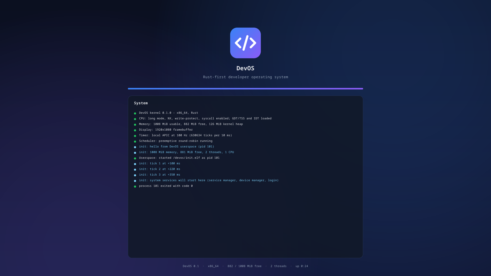

# DevOS

**An open-source, Rust-first operating system with its own kernel — built in the open, from scratch, by anyone who wants to help.**

DevOS does not use the Linux kernel. Everything — bootloader, kernel, drivers, userspace, UI —
is new code, written primarily in **Rust**, with **x86_64 Assembly** only where the hardware
requires it. The long-term goal is a developer-first desktop OS: a native UI toolkit (DevUI),
developer tools, AI-assisted coding, and a hypervisor-based Linux/Windows runtime.



> **Status: early.** DevOS boots on UEFI x86_64 (tested in QEMU/OVMF), manages memory,
> schedules threads preemptively and runs a ring-3 `init` process. There is no desktop,
> filesystem, network or driver stack yet — that is exactly where contributions are needed.
> See the [roadmap](docs/ROADMAP.md).

## What works today

| Component | State |
|---|---|
| `boot/` — UEFI bootloader (Rust) | loads the kernel ELF + init, builds page tables (identity, direct map, higher-half kernel, guarded stack), GOP framebuffer, ACPI RSDP, memory map |
| `kernel/` — kernel (Rust + asm) | GDT/TSS, IDT with assembly entry stubs, physical frame allocator, kernel heap, paging + user address spaces, LAPIC timer, preemptive scheduler with assembly context switch, `syscall`/`sysret`, ELF64 loader, ring-3 processes, safe user-memory copies |
| `libs/devos-abi` | system call ABI: `write, exit, yield, getpid, uptime_ms, sleep_ms, sysinfo` |
| `userland/` | `x86_64-unknown-devos` target, `devos-rt` runtime, `/devos/init` |
| UI | DevUI-styled boot screen: gradient background, anti-aliased logo, live system card |
| `xtask/` | language-policy lint, build, FAT32 ESP + GPT disk image + UEFI ISO, QEMU self-test, screenshots |

## Quick start

Requirements: [Rust](https://rustup.rs) (the pinned nightly in `rust-toolchain.toml` installs
automatically) and Docker (QEMU, OVMF and xorriso run in the `tools/Dockerfile` container, so
the build works the same on Linux, macOS and Windows).

```bash
git clone https://github.com/atillayedek/devos
```

```bash
cd devos
```

```bash
cargo xtask test
```

Builds everything and boots the self-test kernel in QEMU: frame allocator, heap, paging and
scheduler tests, then the ring-3 `init`. Prints `SELFTEST PASSED`.

```bash
cargo xtask run --screenshot boot.png
```

Produces `target/devos/devos.img` (GPT disk; write it to a USB stick with `dd`/Rufus) and
`target/devos/devos.iso` (UEFI ISO), boots it and saves a screenshot. To try the ISO in a VM,
use UEFI firmware (Hyper-V Generation 2 / VirtualBox "Enable EFI") with Secure Boot **off**.

## Repository layout

```
boot/        devos-boot — UEFI bootloader
kernel/      the kernel: arch/x86_64, mm, sched, ui
libs/        devos-bootinfo (boot protocol), devos-abi (syscalls), devos-rt (userspace runtime)
userland/    native DevOS programs (target x86_64-unknown-devos)
targets/     x86_64-unknown-devos.json
xtask/       build tool
tools/       QEMU/OVMF/xorriso container
docs/        language policy, architecture, roadmap
legacy/      archived Linux-based prototype — not part of DevOS
```

## Contributing

Everyone is welcome — first-time contributors included. Read
[CONTRIBUTING.md](CONTRIBUTING.md), pick an issue labelled
[`good first issue`](https://github.com/atillayedek/devos/labels/good%20first%20issue) or a
roadmap item, and open a pull request. The project follows the
[language policy](docs/LANGUAGE-POLICY.md): **Rust first**, Assembly only for low-level CPU work.

Docs: [Architecture](docs/ARCHITECTURE.md) · [Roadmap](docs/ROADMAP.md) ·
[Language policy](docs/LANGUAGE-POLICY.md) · [Security](SECURITY.md) ·
[Code of conduct](CODE_OF_CONDUCT.md)

## License

[MIT](LICENSE). By contributing you agree that your contributions are licensed under the MIT license.

---

## Türkçe

DevOS, sıfırdan yazılan kendi kernel'i olan, **Rust öncelikli açık kaynak bir işletim sistemidir**.
Linux kernel'i kullanılmaz. Herkes katkıda bulunabilir: depoyu fork'layın, bir
`good first issue` seçin ve pull request gönderin. Başlamak için `cargo xtask test` yeterlidir.
Ayrıntılar: [CONTRIBUTING.md](CONTRIBUTING.md). Lisans: **MIT**.
